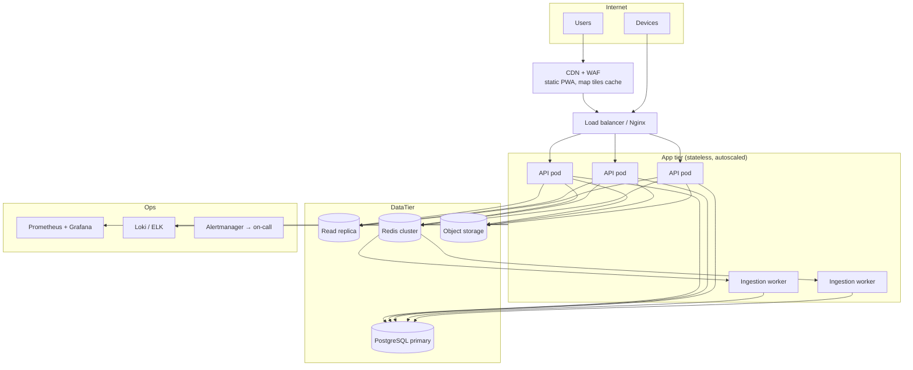

# 3. System Architecture

Godavari Pushkaralu Smart Crowd Management & Pilgrim Assistance Platform ("Pushkar Sahayam").

This document is the source of truth for how the system is put together. The database and API contract is in [04-database-and-api-spec.md](04-database-and-api-spec.md); the technology choices and their justification are in [06-technology-stack.md](06-technology-stack.md).

## 3.1 Design principles

1. **Software first, hardware honest.** Every feature is tagged with what it needs to work for real: software only, or physical infrastructure (RFID readers, cameras, sensors), external services (SMS, push, map tiles), or official cooperation (data feeds, permissions). The app never claims a value is "live" unless the data source is live; every crowd/parking value carries a `source` and `updated_at`.
2. **Degrade gracefully.** Pilgrims have weak connectivity in dense crowds. The mobile app is an installable PWA with cached map tiles for the event area, cached facility data, and a clearly-shown "last updated" timestamp. Read paths work from cache; write paths queue and retry.
3. **Minimal personal data.** Family tracking is opt-in per member with recorded consent. Location lookups are restricted to the member's own family and to authorised staff, and every lookup is written to an audit log.
4. **Simple for everyone.** Three languages (Telugu, Hindi, English), large touch targets, icon-first navigation, a one-tap SOS, and no account required to read crowd, parking, and facility information.
5. **Scale by partitioning.** Read traffic (status, maps) is served from cache and CDN; write traffic (sightings, readings) is batched by edge devices and ingested asynchronously. The event is spread over six districts and 440+ ghats; the system is partitioned per *site* (a cluster of ghats sharing gates and parking) so one site's failure does not affect another.

## 3.2 Context diagram

```mermaid
flowchart LR
    subgraph Users
        P[Pilgrim<br/>mobile PWA]
        F[Family member<br/>mobile PWA]
        V[Volunteer / Field staff<br/>mobile PWA kiosk mode]
        A[Admin / Control room<br/>web dashboard]
    end
    subgraph Edge["On-site infrastructure (hardware)"]
        R[RFID readers at<br/>gates & checkpoints]
        C[CCTV + AI counting<br/>(YOLOv8 pipeline)]
        S[Parking sensors /<br/>boom-barrier counters]
        K[Help-desk kiosks]
    end
    subgraph Platform["Pushkar Sahayam platform"]
        GW[API Gateway / Nginx]
        API[FastAPI application servers]
        WS[WebSocket fan-out]
        ING[Ingestion workers]
        DB[(PostgreSQL + PostGIS)]
        CACHE[(Redis: cache, pub/sub, queues)]
        OBJ[(Object storage: photos)]
    end
    subgraph External["External services"]
        SMS[SMS OTP gateway]
        PUSH[FCM / Web Push]
        TILES[Map tiles (OSM / MapTiler)]
        OSRM[Routing engine (self-hosted OSRM)]
    end
    P & F & V & A --> GW --> API
    API <--> DB
    API <--> CACHE
    API --> OBJ
    API --> SMS
    API --> PUSH
    P & A --> TILES
    R & C & S & K --> GW --> ING --> CACHE --> API
    API --> WS --> P & F & V & A
    API --> OSRM
```

## 3.3 Component view

| Component | Responsibility | Status in this repository |
|---|---|---|
| **Pilgrim PWA** (`frontend/`) | Map, crowd status, routes, parking, facilities, family linking, missing-person report, SOS, alerts, 3 languages | Implemented |
| **Admin dashboard** (`frontend/` → `/admin`) | KPIs, live map, crowd overrides, parking management, missing-person queue, alert broadcast, device registry, audit log | Implemented |
| **Field-staff mode** (`frontend/` → `/staff`) | Manual tag scan at help desks, missing-person lookup, mark found | Implemented |
| **API service** (`backend/app`) | REST + WebSocket, auth, business rules, routing | Implemented |
| **Ingestion endpoints** | Device-authenticated batch endpoints for RFID sightings, camera counts, parking occupancy | Implemented (HTTP). Real devices need the on-site adapters below |
| **Routing service** | Crowd-weighted shortest path over a curated walkway graph of the event site | Implemented (in-process Dijkstra). City-scale turn-by-turn needs self-hosted OSRM |
| **Database** | PostgreSQL in production, SQLite for local dev/tests | Implemented via SQLAlchemy |
| **Real-time fan-out** | WebSocket broadcaster; in-process for one instance, Redis pub/sub for many | In-process implemented; Redis adapter is a documented extension point |
| **Simulators** (`backend/simulators`) | Generate labelled *synthetic* RFID sightings, camera counts, parking events to exercise the pipeline | Implemented, clearly labelled as simulation |
| **AI camera counting** | Person counting from CCTV (the user's earlier YOLOv8 + ByteTrack prototype) | Not in this repo; it posts to `/api/v1/crowd/readings` with a device key |
| **SMS OTP, push notifications** | External gateways | Interfaces implemented; dev mode prints OTP to the server log and to the API response when `DEV_MODE=true` |

## 3.4 Deployment view



Local development uses `docker-compose.yml` (PostgreSQL, API, frontend behind Nginx). A single VM can run the whole stack for a pilot site. Production sizing and cost are in [09-deployment-and-operations.md](09-deployment-and-operations.md).

## 3.5 Data flows

### 3.5.1 Crowd density

```mermaid
sequenceDiagram
    participant Cam as CCTV AI counter / RFID gate / Staff
    participant API as API (ingest)
    participant DB as PostgreSQL
    participant Cache as Redis / in-proc
    participant WS as WebSocket
    participant App as Pilgrim app
    Cam->>API: POST /crowd/readings {location, count, source} (device key)
    API->>API: validate; compute density_level = f(count / capacity)
    API->>DB: insert crowd_reading; update location.current_count
    API->>Cache: set crowd:status (TTL)
    API->>WS: publish crowd.updated
    WS-->>App: crowd.updated {location_id, level, updated_at}
    App->>API: GET /crowd/status (on open / reconnect)
```

Sources and their trust order: `camera` (AI count), `rfid` (gate in/out counters), `manual` (staff at the spot), `estimate` (decayed from the last reading). The density level is computed from the ratio of count to the location's safe capacity: `low` < 40 %, `moderate` 40–70 %, `high` 70–90 %, `critical` ≥ 90 %. Readings older than `CROWD_STALE_SECONDS` (default 15 min) are shown as *stale* and the level is marked `unknown` unless a staff override is active.

### 3.5.2 RFID family tracking (checkpoint model)

RFID gives **presence at a reader**, not a continuous position. The platform therefore implements a *checkpoint model*:

```mermaid
sequenceDiagram
    participant Tag as Wristband (UHF RFID tag)
    participant Reader as Gate / checkpoint reader
    participant Edge as Edge gateway (buffers, dedupes)
    participant API as API /rfid/sightings
    participant DB as PostgreSQL
    participant Fam as Family member app
    Tag-->>Reader: tag UID read (passive, 3-8 m, no battery)
    Reader->>Edge: UID, antenna, RSSI, timestamp
    Edge->>Edge: dedupe (same UID within 30 s), buffer offline
    Edge->>API: POST batch (device key)
    API->>DB: insert tag_sightings; update tag.last_seen
    API->>Fam: WS sighting event (only to consented family)
    Fam->>API: GET /families/{id}/members/{m}/last-seen (audited)
```

* **What RFID provides**: last checkpoint passed, time, direction (entry vs exit antenna). Read range 3–8 m for UHF passive tags in a portal; read rate good for walking speed.
* **What RFID cannot provide**: position between checkpoints, floor-level precision, or guarantee of reads in very dense crowds (body water attenuates UHF). The architecture compensates with: dense checkpoint placement at every gate, ghat entrance/exit, help desk, medical post and bus stop; **BLE beacon** option for help-desk-level "is the child inside this enclosure" proximity; **GPS** from the phone for adult members who opt in (shares own position to family, every 60 s, foreground only); and **QR** printed on the wristband so any volunteer with the app can scan it manually when a reader is unavailable.
* **Consent and access**: a tag can only be linked to a member by the family's primary account, with the consent box recorded (`consent_given_at`, `consent_by_user_id`). Minors are linked by a guardian. A member can unlink at any time. Last-seen lookups are available to the family and to staff handling an open missing-person report for that member; each lookup is logged in `audit_logs` with actor, purpose and report id.
* **Retention**: sightings are kept for the festival period plus 30 days, then deleted; aggregated counts are kept.

### 3.5.3 Missing-person workflow

```mermaid
stateDiagram-v2
    [*] --> open: Reporter submits (app or help desk)
    open --> verified: Staff verifies caller and details
    open --> rejected: Duplicate / false / insufficient
    verified --> searching: Assigned to help desk; last-seen fetched; alert pushed to nearby staff
    searching --> found: Person located at a help desk / by staff
    found --> closed: Reunited and confirmed by reporter
    searching --> closed: Withdrawn by reporter
    closed --> [*]
    rejected --> [*]
```

Safeguards: OTP-verified reporter phone; rate limit of 3 open reports per account; photo is optional and only shown to staff; public lost-and-found board shows only non-identifying summary (age group, clothing colour, help desk holding the person) without photo; all state changes recorded in `report_events`.

### 3.5.4 Parking

Occupancy comes from (a) boom-barrier/loop counters posting `+1/-1`, (b) staff tapping a counter in the app, or (c) QR-pass scans at entry. The lot status is `open`, `filling` (≥ 80 %), `full`, `closed`. Pilgrims see the recommended lot for their chosen ghat (nearest lot with free slots, walking distance, shuttle info) and can save "my spot" (lot + row label + photo) for return.

### 3.5.5 Navigation

The event site walkway graph is curated by the organisers (nodes at gates, junctions, ghat entrances, facilities; edges with length, accessibility flag, and open/closed flag). Route cost = length × crowd multiplier of the edge's zone (`low` 1.0, `moderate` 1.3, `high` 2.0, `critical` ∞ i.e. avoided, `closed` ∞). The server returns the polyline, turn list, distance and ETA at 3.5 km/h (2.5 km/h for `accessible=true`). Off-site road routing (city to parking) is delegated to the phone's native map app via a deep link, or to a self-hosted OSRM instance when deployed.

## 3.6 Security architecture

* **Identities**: pilgrims authenticate with phone + OTP (JWT access token, 12 h); staff/admins with username + password + role; devices with a per-device API key (hashed at rest) sent as `X-Device-Key`.
* **Authorisation**: role-based (`pilgrim`, `volunteer`, `staff`, `admin`) plus resource ownership checks (family membership, report ownership). Field staff see missing-person details only for reports assigned to their help desk or site.
* **Transport**: TLS everywhere; HSTS; WebSocket over WSS.
* **Data protection**: phone numbers and names are personal data under the DPDP Act 2023; stored minimised, encrypted at rest (disk-level), access audited, retention limited. Photos stored in object storage with signed URLs, never in the public board.
* **Abuse controls**: OTP rate limit (5 per phone per hour), report rate limit, device key revocation, input validation with Pydantic, structured audit log.
* **Operational**: secrets from environment/secret manager, no secrets in the repo, dependency pinning, CORS allow-list, security headers from Nginx.

## 3.7 Scalability and reliability

| Concern | Approach |
|---|---|
| 1 crore bathers/day, peak app users perhaps 20–30 lakh concurrent across sites | Static PWA on CDN; status endpoints cached (5–15 s TTL) in Redis and at the edge; WebSocket fan-out of deltas only; per-site sharding of channels |
| RFID sightings: 440 ghats × several readers × up to 10 reads/s at peak | Edge dedupe and batching (reduces 10×); ingestion queue in Redis Streams; workers write in bulk; partitioned `tag_sightings` by day |
| Loss of connectivity at site | Edge gateways buffer up to 24 h of sightings; app caches last status and map tiles; help desks have a local kiosk mode |
| Database | PostgreSQL primary + read replica; PgBouncer pooling; time-series tables partitioned; nightly backups + PITR |
| Observability | Prometheus metrics (`/metrics`), structured JSON logs, Grafana dashboards per site, alert rules on ingestion lag, WS fan-out lag, error rate |
| Disaster recovery | Multi-AZ; infra as code; restore drill before the festival; read-only "static mode" page served from CDN if the API is down |

## 3.8 What needs hardware, external services, or official cooperation

| Feature | Software only | Needs hardware | Needs external service | Needs official cooperation |
|---|---|---|---|---|
| Facility locator, map, directions on site | ✔ (curated data) | – | Map tiles (OSM free tier or MapTiler) | Facility list and coordinates from organisers |
| Crowd density (manual staff updates) | ✔ | – | – | Staff rota at each ghat/gate |
| Crowd density (automatic) | – | CCTV + GPU AI counters, or RFID/turnstile counters | – | CCTV feed access, camera placement |
| RFID family tracking | – | UHF readers at checkpoints, wristband tags, edge gateways, power/network | – | Checkpoint locations, tag distribution desks |
| GPS self-location sharing (adults) | ✔ | – | – | – |
| Parking occupancy (manual) | ✔ | – | – | Parking staff |
| Parking occupancy (automatic) | – | Loop counters / boom barriers / ANPR cameras | – | Parking contractor |
| Digital parking pass (QR) | ✔ | Scanner phone at entry | – | Parking operator adoption |
| Missing-person reports and help-desk workflow | ✔ | – | SMS OTP gateway | Police / help-desk SOP integration |
| Alerts and notifications | ✔ (in-app) | – | FCM / Web Push, SMS for broadcast | Control-room authority to issue alerts |
| Emergency SOS | ✔ (creates request + shows contacts) | – | Telephony (112 integration is manual) | Police/medical dispatch SOP |
