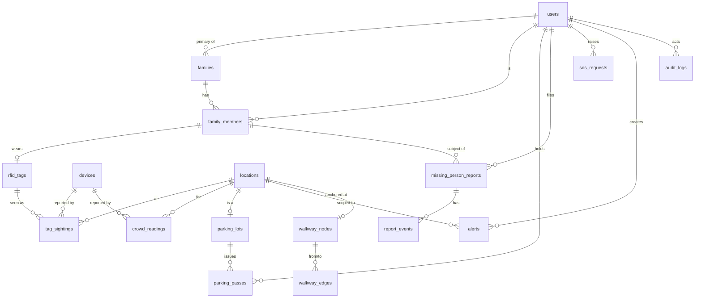

# 4. Database Schema and API Specification

Implemented in `backend/app/models.py` (schema) and `backend/app/routers/*` (API). The live, machine-readable contract is served by the API at `/docs` (Swagger UI) and `/openapi.json`.

## 4.1 Entity-relationship diagram

## 4.2 Tables

Conventions: `id` is an integer primary key unless stated; timestamps are UTC ISO-8601; soft personal data is marked **PD**.

### users
| column | type | notes |
|---|---|---|
| id | int PK | |
| phone | text unique **PD** | E.164, e.g. `+919876543210` |
| name | text **PD** | optional for pilgrims |
| role | enum | `pilgrim`, `volunteer`, `staff`, `admin` |
| username | text unique nullable | staff/admin login |
| password_hash | text nullable | PBKDF2-SHA256 |
| preferred_lang | text | `te`, `hi`, `en` |
| site_id | int nullable | staff assignment (site = group of locations) |
| is_active | bool | |
| created_at | timestamp | |

### otp_codes
`id, phone, code_hash, expires_at, attempts, consumed_at` — rate-limited per phone.

### locations
| column | type | notes |
|---|---|---|
| id | int PK | |
| code | text unique | e.g. `GHAT-PUSHKAR`, `GATE-A1` |
| site_id | int | grouping (e.g. Rajamahendravaram Pushkar Ghat site) |
| type | enum | `ghat`, `gate`, `parking`, `checkpoint`, `help_desk`, `medical`, `restroom`, `water`, `dressing_room`, `food`, `rest_area`, `police`, `lost_found`, `bus_stop`, `shuttle`, `other` |
| name, name_te, name_hi | text | trilingual |
| lat, lng | float | WGS84 |
| capacity | int nullable | safe simultaneous occupancy (ghats/gates) |
| is_accessible | bool | wheelchair/elderly friendly |
| is_open | bool | |
| current_count | int nullable | denormalised latest reading |
| density_level | enum | `low`, `moderate`, `high`, `critical`, `unknown` |
| density_source | enum nullable | `camera`, `rfid`, `manual`, `estimate` |
| density_updated_at | timestamp nullable | |
| override_level | enum nullable | staff override wins over readings until `override_until` |
| override_until | timestamp nullable | |
| details | json | opening hours, phone, facilities list, shuttle info |

### crowd_readings
`id, location_id FK, count, density_level, source, device_id FK nullable, reported_by FK users nullable, recorded_at` — partition by day in production.

### devices
`id, name, type (rfid_reader|camera|parking_counter|kiosk), api_key_hash, location_id FK nullable, status, last_seen_at, created_at`. The plaintext key is returned once at creation.

### parking_lots
`id, location_id FK unique, total_slots, occupied_slots, vehicle_types (json), nearest_gate_id FK locations, shuttle_info, status (open|filling|full|closed), updated_at, source`.

### parking_passes
`id, user_id FK, lot_id FK, vehicle_number **PD**, vehicle_type, qr_token unique, issued_at, used_at, status (issued|used|cancelled)`.

### parking_spots (remember my vehicle)
`id, user_id FK, lot_id FK, row_label, note, photo_path, saved_at`.

### families
`id, name, primary_user_id FK, join_code unique (6 chars), created_at`.

### family_members
| column | notes |
|---|---|
| id, family_id FK | |
| user_id FK nullable | linked app account if the member has one |
| display_name **PD**, age_group (`child`, `adult`, `senior`), relation | |
| is_vulnerable | child/senior/disabled flag drives help-desk priority |
| phone **PD** nullable | |
| rfid_tag_uid FK nullable | the wristband |
| consent_given_at, consent_by_user_id | required before a tag or GPS can be linked |
| gps_sharing | bool, self-opt-in for adults |
| last_lat, last_lng, last_gps_at | from GPS sharing |

### rfid_tags
`uid text PK, member_id FK nullable, status (issued|active|unlinked|lost), issued_at, last_seen_at, last_location_id FK`.

### tag_sightings
`id bigint, tag_uid FK, device_id FK, location_id FK, antenna, rssi, direction (in|out|unknown), seen_at, received_at`. Partitioned by day, retained festival + 30 days.

### missing_person_reports
| column | notes |
|---|---|
| id | |
| reporter_user_id FK | |
| member_id FK nullable | when the subject is a family member (enables last-seen lookup) |
| subject_name **PD**, age, gender, description, clothing | |
| photo_path **PD** nullable | signed-URL, staff only |
| last_seen_location_id FK nullable, last_seen_at | |
| contact_phone **PD** | |
| status | `open`, `verified`, `searching`, `found`, `closed`, `rejected` |
| assigned_staff_id FK nullable, help_desk_location_id FK nullable | |
| created_at, updated_at, resolved_at | |

### report_events
`id, report_id FK, actor_id FK, event_type, note, created_at` — immutable audit of the workflow.

### alerts
`id, title, body, title_te, body_te, title_hi, body_hi, severity (info|warning|critical), site_id nullable, location_id nullable, starts_at, expires_at, created_by FK, created_at`.

### sos_requests
`id, user_id FK nullable, phone **PD**, lat, lng, type (medical|police|lost_child|fire|other), note, status (new|acknowledged|dispatched|resolved), assigned_to FK nullable, created_at, updated_at`.

### walkway_nodes / walkway_edges
`walkway_nodes: id, site_id, lat, lng, location_id FK nullable, label`
`walkway_edges: id, from_node FK, to_node FK, length_m, is_accessible, is_closed, zone_location_id FK nullable (for crowd weighting)`

### audit_logs
`id, actor_id FK nullable, device_id FK nullable, action, entity, entity_id, purpose, ip, created_at`.

## 4.3 Indexes that matter
* `tag_sightings (tag_uid, seen_at desc)`; `tag_sightings (location_id, seen_at desc)`
* `crowd_readings (location_id, recorded_at desc)`
* `locations (site_id, type)`; spatial index on `(lat, lng)` (PostGIS `geography` in production)
* `missing_person_reports (status, help_desk_location_id)`
* `otp_codes (phone, expires_at)`

## 4.4 API

Base path `/api/v1`. JSON unless stated. Errors follow `{ "detail": "..." }` with proper HTTP codes. Authentication: `Authorization: Bearer <jwt>` for users, `X-Device-Key: <key>` for devices. Roles in brackets.

### Auth
| Method | Path | Who | Purpose |
|---|---|---|---|
| POST | `/auth/otp/request` | public | `{phone, lang}` → sends OTP (dev mode returns `dev_otp`) |
| POST | `/auth/otp/verify` | public | `{phone, code, name?}` → `{access_token, user}` |
| POST | `/auth/login` | public | `{username, password}` → token (staff/admin) |
| GET | `/auth/me` | any | current user |
| PATCH | `/auth/me` | any | `{name?, preferred_lang?}` |

### Locations & facilities
| GET | `/locations` | public | filters `type`, `site_id`, `near=lat,lng`, `radius_m`, `accessible`, `open`; returns distance when `near` given |
| GET | `/locations/{id}` | public | full details |
| POST/PATCH | `/locations`, `/locations/{id}` | admin | manage |

### Crowd
| GET | `/crowd/status` | public | all monitored locations with level, count, source, updated_at, `is_stale` |
| GET | `/crowd/{location_id}/history?hours=6` | public | readings for charts |
| POST | `/crowd/readings` | device or staff | `{location_id|location_code, count, source?}`; batch allowed |
| POST | `/crowd/{location_id}/override` | staff/admin | `{level, minutes, reason}` |
| GET | `/crowd/recommendations?for=ghat&near=lat,lng` | public | ranked less-crowded alternatives with distance |

### Routes
| GET | `/routes?from=lat,lng&to=<location_id>&accessible=false&avoid_crowd=true` | public | `{polyline:[[lat,lng]], distance_m, eta_min, steps:[...], crowd_notes:[...]}` |

### Parking
| GET | `/parking` | public | lots with occupancy, status, nearest gate, distance |
| GET | `/parking/recommend?ghat=<id>&vehicle=car` | public | best lot |
| POST | `/parking/{lot_id}/occupancy` | device/staff | `{delta}` or `{occupied}` |
| PATCH | `/parking/{lot_id}` | staff/admin | status, slots |
| POST | `/parking/passes` | pilgrim | `{lot_id, vehicle_number, vehicle_type}` → pass with `qr_token` |
| GET | `/parking/passes/mine` | pilgrim | |
| POST | `/parking/passes/{qr_token}/scan` | staff/device | marks used, increments occupancy |
| PUT | `/parking/my-spot` | pilgrim | `{lot_id, row_label, note}` |
| GET | `/parking/my-spot` | pilgrim | |

### Families & RFID
| POST | `/families` | pilgrim | create, returns `join_code` |
| POST | `/families/join` | pilgrim | `{join_code}` |
| GET | `/families/mine` | pilgrim | family + members + last seen (if consented) |
| POST | `/families/{id}/members` | primary | add member |
| PATCH | `/families/{id}/members/{mid}` | primary/self | details, `gps_sharing` |
| DELETE | `/families/{id}/members/{mid}` | primary | |
| POST | `/families/{id}/members/{mid}/tag` | primary | `{tag_uid, consent: true}` → links wristband |
| DELETE | `/families/{id}/members/{mid}/tag` | primary/self | unlink |
| GET | `/families/{id}/members/{mid}/last-seen` | family/staff | audited lookup: last checkpoint(s), GPS if shared |
| POST | `/families/{id}/members/{mid}/gps` | self | `{lat,lng}` (opt-in) |
| POST | `/rfid/sightings` | device | batch `[{tag_uid, antenna?, rssi?, direction?, seen_at}]` |
| POST | `/rfid/manual-scan` | volunteer/staff | `{tag_uid, location_id}` (QR fallback) |
| GET | `/rfid/tags/{uid}` | staff | status + last seen (audited) |
| POST | `/rfid/tags` | staff | issue tags `[{uid}]` |

### Missing persons
| POST | `/missing-reports` | pilgrim/staff | multipart: fields + optional photo |
| GET | `/missing-reports/mine` | pilgrim | |
| GET | `/missing-reports` | staff | filters `status`, `help_desk`, `site_id` |
| GET | `/missing-reports/{id}` | owner/staff | |
| PATCH | `/missing-reports/{id}` | staff | `{status, assigned_staff_id?, help_desk_location_id?, note}` |
| GET | `/missing-reports/{id}/events` | owner/staff | timeline |
| GET | `/missing-reports/board` | public | non-identifying found-persons board |

### Alerts, SOS, emergency
| GET | `/alerts/active?site_id&lang` | public | |
| POST | `/alerts` | admin | |
| DELETE | `/alerts/{id}` | admin | expire now |
| POST | `/sos` | any (phone required if anonymous) | creates request, returns nearest medical/police/help desk |
| GET | `/sos` | staff | queue |
| PATCH | `/sos/{id}` | staff | status |
| GET | `/emergency/contacts?site_id` | public | numbers, nearest posts |

### Admin & ops
| GET | `/admin/overview` | admin/staff | KPIs: by level counts, open reports, SOS, parking totals, devices online |
| GET/POST/DELETE | `/admin/devices` | admin | device registry, key issued once |
| GET | `/admin/audit?limit` | admin | |
| GET | `/admin/sightings/recent` | admin | ingestion health |
| GET | `/health` | public | liveness + DB check |
| GET | `/metrics` | internal | Prometheus text format |

### WebSocket `/ws/live?token=<jwt optional>&site_id=`
Server → client events (`{type, data, ts}`):
* `crowd.updated` {location_id, density_level, current_count, source, updated_at}
* `parking.updated` {lot_id, occupied_slots, status}
* `alert.created` / `alert.expired`
* `sighting` {member_id, location_id, seen_at} — only to sockets authenticated as members of that family
* `report.updated` {id, status} — to reporter and to staff
* `sos.created` — to staff sockets
* `ping` every 25 s

## 4.5 Real-time data flow and caching
* Status reads are served from an in-memory/Redis cache with a 5 s TTL and `ETag` support.
* Writes publish deltas to the broadcaster; clients apply deltas and reconcile with a full `GET` on reconnect.
* Device batches are accepted with `202 Accepted` after validation; persistence is synchronous in this implementation and queued (Redis Streams) in the scaled deployment.
