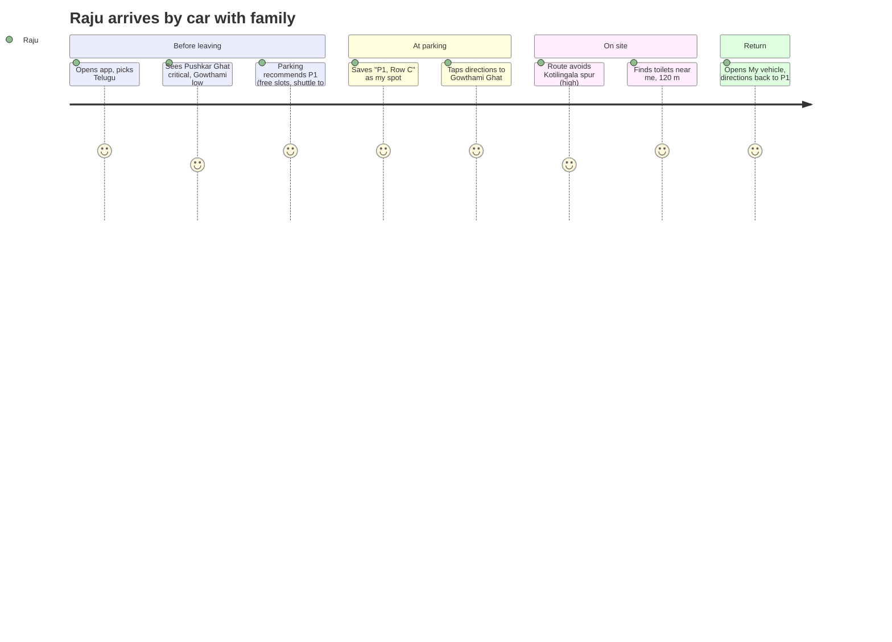

# 5. User Journeys and UI/UX Design

## 5.1 UX principles

1. **Icon-first, three words max.** Every tile and nav item has an emoji/icon plus one short label in the selected language; elderly users recognise 🚰 before they read "Drinking water".
2. **Big targets, big text.** Minimum 48 px touch targets, 64 px for primary actions, 17 px base font (`styles.css`), 1.45 line height.
3. **Trilingual everywhere.** Telugu default, Hindi, English; switch is always visible in the top bar; location names carry `name_te`/`name_hi`.
4. **Truth in data.** Every crowd/parking value shows a `DensityChip`, source (camera AI / RFID / staff / estimate) and "updated X min ago"; stale data is grey and labelled, never shown as live.
5. **No account for reading.** Crowd, map, facilities, parking, alerts, board and emergency contacts need no login; OTP login is asked only when a personal action starts (family, report, pass).
6. **Two-tap SOS.** The red SOS button is always in the top bar; it opens the Emergency page where the user picks a type and confirms — no accidental dispatch.
7. **Offline tolerance.** PWA caches tiles, reference data and last status; an orange "Offline — showing last known information" banner appears.
8. **Live indicator.** "● Live" in the header when the WebSocket is connected.
9. **Minimal personal data.** Forms ask only for what the help desk needs; consent text is shown in the user's language before linking a wristband or uploading a photo.
10. **Staff mode is three actions.** Scan wristband, handle report, handle SOS.

## 5.2 User journeys

### J1 — First-time pilgrim arriving by car


### J2 — Elderly pilgrim seeking an accessible ghat
Subbamma's daughter opens Crowd → filter "Seniors / disabled" → sees Padmavathi Ghat (accessible, low) and Gate D → Directions with *accessible* on → route avoids stair edges (Gowthami spur is excluded) → rest area and medical post shown as nearby facilities.

### J3 — Parent whose child is missing
1. Lakshmi earlier created the family, added "Chinnu (child)", linked wristband GP27-00010 after reading the consent text.
2. Chinnu disappears near Pushkar Ghat. Family tab → Chinnu → **Last seen: Checkpoint 2, 6 min ago** with nearest help desks (Help Desk 2, 80 m).
3. Taps **Report missing** → form pre-filled from the member (name, age group) → adds clothing "red shirt" → optional photo with consent → submit.
4. Status card shows `open`; volunteers near the site receive `report.created` (vulnerable flag).
5. Status updates arrive live: `verified` → `searching` → `found at Help Desk 2`. Directions to Help Desk 2. She confirms `closed` after reunion.

### J4 — Volunteer at help desk reuniting a child
Kiran (staff mode, logged in as `helpdesk2`): child brought to desk → **Scan wristband** (type UID or scan QR) → sees "Chinnu, child, vulnerable, family contact +91…" → calls family → opens report queue, moves report to `found` (desk auto-filled) → child appears on public board as "child, male, red shirt, at Help Desk 2" → marks `closed` after guardian verification per SOP.

### J5 — Control-room operator during a surge
Dashboard shows Pushkar Ghat `critical` (camera AI, 14,200/15,000). Operator: (1) sets Gate B override `critical` for 30 min with reason "Pushkar Ghat at capacity"; (2) publishes a warning alert in three languages "Use Gate A/C, Gowthami and Saraswathi ghats are open"; (3) watches recommendations shift; (4) clears override when count falls below 70 %.

### J6 — Parking operator
At P2 boom barrier with a phone: scans QR passes (occupancy +1 each) or taps +/- in staff mode; when full, marks `full`; app recommendations instantly move to P1/P4; marks `open` again when it clears.

## 5.3 Screen inventory

### Pilgrim app (`/`)
| Route | Screen | Content |
|---|---|---|
| `/` | Home | alert strip, ghat status tiles with density chips, quick tiles (Map, Parking, Facilities, Family, Missing, Emergency), recommended ghat, demo-data note |
| `/map` | Map | Leaflet map, layer chips by type, "near me", tap marker → popup → Directions; route sheet with distance/ETA/steps/crowd notes; `?to=<id>` deep link |
| `/crowd` | Crowd | tabs Ghats / Gates, list with chip + meter + count/capacity + source + updated, "Less crowded ghats" recommendations, accessible filter |
| `/parking` | Parking | lot cards (free/total, status, nearest gate, shuttle), recommend by ghat, Remember my spot, Digital pass (login) |
| `/facilities` | Facilities | type filter chips, near-me sorted list, accessible toggle |
| `/family` | Family | login gate; create/join; member cards with last seen + GPS; add member; link/unlink wristband with consent; share my location toggle |
| `/missing` | Missing person | report form (optional photo + consent), my reports with live status + timeline, public found board |
| `/emergency` | Emergency | SOS type buttons → confirm → result with call buttons (112/108/100) and nearest posts; contacts list |
| `/more` | More | Facilities, Missing, Parking, Emergency, Profile/Language, Staff mode, Admin, about/privacy |
| `/login` | Login | phone → OTP → name; dev OTP shown only in dev mode |
| `/staff` | Staff mode | scan wristband, report queue, SOS queue, quick crowd update for my location |

### Admin dashboard (`/admin`)
| Route | Screen |
|---|---|
| `/admin/login` | username/password |
| `/admin` | KPIs (levels, stale, reports by status, SOS, parking, devices online, ingestion, WS), live map, latest events |
| `/admin/crowd` | table of monitored locations: level, count, capacity, source, age, override controls, manual reading |
| `/admin/parking` | lots: occupancy edit, status, slots, shuttle info |
| `/admin/reports` | queue with filters, detail with timeline, photo (audited), transitions, assign desk |
| `/admin/alerts` | create trilingual alert, severity, scope, expiry; active list, expire |
| `/admin/devices` | registry, create (key shown once), revoke, last seen; recent masked sightings |
| `/admin/audit` | audit log with action filter |

## 5.4 Design tokens (from `frontend/src/styles.css`)

| Token | Light | Dark | Use |
|---|---|---|---|
| `--saffron` | #B5451B | same | primary actions, header |
| `--river` | #0B6E7A | same | directions, secondary |
| `--gold` | #F6C453 | same | accents |
| `--bg` / `--surface` | #FBF7F0 / #FFFFFF | #15120F / #1F1A16 | page / cards |
| `--text` / `--muted` | #1E1B16 / #6B6257 | #F3EDE3 / #B5A897 | |
| `--low` | #2E7D32 | | density low |
| `--moderate` | #C98A00 | | density moderate |
| `--high` | #E65100 | | density high |
| `--critical` | #C62828 | | density critical, SOS |
| `--unknown` | #78909C | | stale / no data |
| radius | 16 px cards, 10 px controls | | |
| nav height | 64 px + safe area | | |

Density colours are paired with text labels and chips, never colour alone (colour-blind safe). Dark mode follows `prefers-color-scheme`.

## 5.5 Low-fidelity wireframes

### Home
```
┌──────────────────────────────────────────────┐
│ పుష్కర సహాయం      [తెలుగు][हिन्दी][English] 🆘 SOS │
│ గోదావరి పుష్కరాలు 2027 · ● Live               │
├──────────────────────────────────────────────┤
│ ⚠ Gate B closed — use Gate A or C            │
├──────────────────────────────────────────────┤
│ ఘాట్లు ఇప్పుడు                                 │
│ ┌────────────┐ ┌────────────┐ ┌────────────┐ │
│ │🌊 Gowthami │ │🌊 Kotiling.│ │🌊 Pushkar  │ │
│ │ ● Low      │ │ ● High     │ │ ● Critical │ │
│ │ 2,100/8,000│ │ 7,600/10k  │ │ 14,200/15k │ │
│ └────────────┘ └────────────┘ └────────────┘ │
│ ✅ సిఫార్సు: Gowthami Ghat — 1.1 km  [🧭 దారి] │
├──────────────────────────────────────────────┤
│ ┌──────┐ ┌──────┐ ┌──────┐                    │
│ │ 🗺️   │ │ 🅿️   │ │ 🚻   │                    │
│ │ మ్యాప్ │ │పార్కింగ్│ │సౌకర్యాలు│                  │
│ └──────┘ └──────┘ └──────┘                    │
│ ┌──────┐ ┌──────┐ ┌──────┐                    │
│ │👨‍👩‍👧   │ │ 🔎   │ │ 🏥   │                    │
│ │కుటుంబం│ │తప్పిపోయిన│ │అత్యవసరం│                │
│ └──────┘ └──────┘ └──────┘                    │
│ ℹ Demo data: positions not surveyed          │
├──────────────────────────────────────────────┤
│  🏠 హోమ్   🗺️ మ్యాప్   👥 రద్దీ   👨‍👩‍👧 కుటుంబం  ☰ మరిన్ని │
└──────────────────────────────────────────────┘
```

### Map with route sheet
```
┌──────────────────────────────────────────────┐
│ [ఘాట్లు][గేట్లు][🅿️][🚻][🚰][🏥][🙋] [📍 నా దగ్గర]  │
│                                              │
│        🌊(green)        🚪(orange)           │
│               ━━━━━━━━━━━━━━━━┓              │
│   🔵 me ━━━━━━━┛  route        ┃              │
│                             🌊(red) avoided  │
│                                              │
├──────────────────────────────────────────────┤
│ ▬▬                                           │
│ 🧭 Gowthami Ghat        1.1 km · 19 min      │
│ [☑ రద్దీని తప్పించు] [☐ సులభ ప్రవేశం]            │
│ ⚠ Kotilingala Ghat is high right now         │
│ 1. Walk south-west 210 m towards Gate A      │
│ 2. Walk south 160 m towards Checkpoint 1     │
│ 3. Arrive at Gowthami Ghat                   │
└──────────────────────────────────────────────┘
```

### Family
```
┌──────────────────────────────────────────────┐
│ నా కుటుంబం: Ravi family     కోడ్: K7P2QX [📤]  │
├──────────────────────────────────────────────┤
│ 👤 Ravi (self)        📍 Gate A · 12 min ago  │
│ 👧 Chinnu (child) ⚠    📍 CP-2 · 6 min ago    │
│    🏷 GP27-00010 · consent 31 Oct             │
│    [🔎 Last seen] [🧭 Help desk 80 m] [Report] │
│ 👵 Amma (senior)      ❔ not yet detected     │
│    [🏷 రిస్ట్‌బ్యాండ్ లింక్ చేయి]                    │
│ 👤 Lakshmi            📡 GPS 2 min ago        │
├──────────────────────────────────────────────┤
│ [+ సభ్యుడిని జోడించు]   [☑ నా స్థానాన్ని పంచుకో] │
└──────────────────────────────────────────────┘
```

### Missing-person report
```
┌──────────────────────────────────────────────┐
│ 🔎 తప్పిపోయినట్లు నివేదించు                       │
│ కుటుంబ సభ్యుడు: [Chinnu (child) ▼]             │
│ పేరు*        [Chinnu                       ]  │
│ ఫోన్*        [+91 90000 00001              ]  │
│ వయసు [6]  లింగం [male ▼]                       │
│ దుస్తులు     [red shirt, blue shorts        ]  │
│ చివరి ప్రదేశం [Pushkar Ghat ▼]                  │
│ ఫోటో (ఐచ్ఛికం) [📷 Choose]                      │
│ ☐ ఈ ఫోటోను అధికారులు గుర్తింపు కోసం మాత్రమే…     │
│ [        సమర్పించు (64 px)        ]           │
├──────────────────────────────────────────────┤
│ నా నివేదికలు                                  │
│ #12 Chinnu   ● searching   Help Desk 2        │
│   created → verified → searching             │
└──────────────────────────────────────────────┘
```

### Admin dashboard
```
┌────────────┬─────────────────────────────────────────────────┐
│ Overview   │ KPIs                                            │
│ Crowd      │ ┌──────┐┌──────┐┌──────┐┌──────┐┌──────┐┌─────┐ │
│ Parking    │ │Crit 2││High 1││Stale0││Open 3││SOS 1 ││Dev9/9│ │
│ Reports    │ └──────┘└──────┘└──────┘└──────┘└──────┘└─────┘ │
│ Alerts     │ ┌────────────────────────┐ ┌───────────────────┐│
│ Devices    │ │ Live map               │ │ Latest events     ││
│ Audit      │ │  🌊🌊🌊 🚪🚪 🅿️🅿️        │ │ crowd.updated …   ││
│            │ │                        │ │ report.created ⚠  ││
│ ─────────  │ └────────────────────────┘ │ sos.created       ││
│ staff1     │ Monitored locations                             │
│ [Log out]  │ Name        Level     Count/Cap  Src   Age  ▸  │
│            │ Pushkar     CRITICAL  14200/15k  cam   1m  [Ovr]│
└────────────┴─────────────────────────────────────────────────┘
```

## 5.6 Accessibility checklist

- [ ] All interactive elements ≥ 48 × 48 px; primary ≥ 64 px
- [ ] Colour never the only signal (chip text + dot + meter)
- [ ] Contrast ≥ 4.5:1 for text in both themes
- [ ] `aria-label` on icon-only buttons (directions, SOS, language)
- [ ] `role="meter"` with values on occupancy bars
- [ ] Sheets are `role="dialog"`, close on Escape and backdrop
- [ ] Focus visible; logical tab order; `lang` attribute follows selected language
- [ ] `prefers-reduced-motion` respected
- [ ] Text scales with OS font size (rem units)
- [ ] Map has list alternative (Crowd/Facilities pages) for screen-reader users
- [ ] Forms: labels bound to inputs, errors in text, no time limits
- [ ] Telugu/Hindi fonts fall back to Noto Sans Telugu/Devanagari
