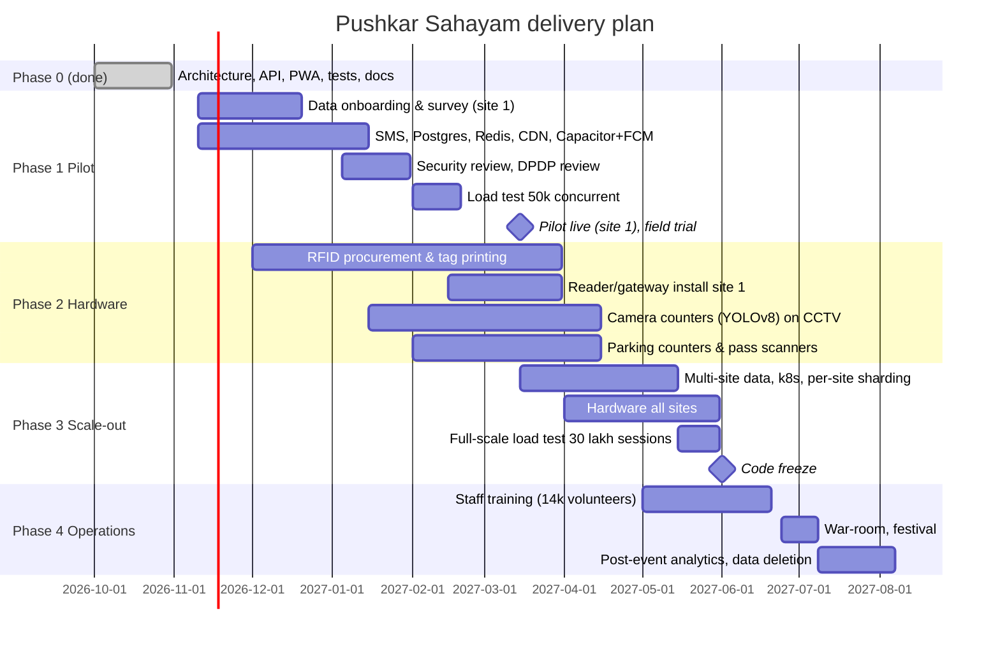

# 7. Phased Development Roadmap

Today: 31 October 2026. Festival: 26 June – 7 July 2027. Working backwards, the full stack must be frozen by **1 June 2027** (code freeze + load test), hardware installed by **15 May 2027**, pilot live at one Rajamahendravaram site by **15 March 2027**.

## 7.1 Phase 0 — Foundation (complete, this repository)

Delivered: architecture and API contract; FastAPI backend with auth (OTP dev mode, staff passwords, device keys), crowd readings/overrides/recommendations, crowd-aware routing, parking lots/passes/spot, families/consent/tag linking/sightings/last-seen with audit, missing-person workflow with photo and public board, SOS and alerts, admin overview/devices/users/audit, WebSocket fan-out; PWA frontend (pilgrim, staff, admin) in te/hi/en; demo seed for a Rajamahendravaram site; 40 backend tests; simulators; docs 01–09.

## 7.2 Phase 1 — Pilot at one site (Nov 2026 – Mar 2027)

Team: 2 backend, 2 frontend, 1 DevOps, 1 QA, 1 PM/field liaison. ~16 weeks.

| Work item | Priority | Effort |
|---|---|---|
| Survey and onboard real data: ghats, gates, facilities, capacities, walkway graph (CSV/GeoJSON import tool) | Must | 3 wk (field) + 1 wk (tool) |
| PostgreSQL + PostGIS, Alembic migrations, partitioning | Must | 1 wk |
| Redis cache + pub/sub broadcaster + Streams ingestion workers | Must | 2 wk |
| SMS gateway (DLT templates), OTP in production mode | Must | 1 wk |
| Capacitor Android/iOS shells, FCM push for report/alert events; Web Push | Should | 2 wk |
| Object storage for photos with signed URLs and lifecycle | Must | 3 d |
| CDN + Nginx hardening + WAF rules | Must | 1 wk |
| Observability stack and alert rules | Must | 1 wk |
| Security review (OWASP ASVS L2), DPDP assessment, privacy notice in 3 languages | Must | 2 wk |
| Load test to 50k concurrent on pilot cluster | Must | 1 wk |
| Staff mode field trial with 20 volunteers; UX fixes | Must | 2 wk |

Exit criteria: pilot site live with manual crowd updates and QR fallback; p95 ≤ 300 ms at 50k concurrent; zero P0 security findings.

## 7.3 Phase 2 — Hardware integration (Dec 2026 – Apr 2027)

| Work item | Priority | Notes |
|---|---|---|
| Wristband procurement (UHF EPC Gen2, printed QR), tag issuing tool (`POST /rfid/tags` bulk) | Must | lead time 8–12 weeks |
| Reader + gateway firmware: dedupe, buffer, batch POST, health heartbeat | Must | 4 wk, 1 embedded engineer |
| Camera counters: productionise the YOLOv8 + ByteTrack prototype (earlier trials) as a service posting line-crossing counts every 30 s per camera | Should | 4 wk + GPU boxes |
| Parking loop counters / barrier integration; pass scanner mode in staff app | Should | 3 wk |
| BLE beacons at help desks | Could | 2 wk |
| Field calibration: read-rate tests in crowd simulations, antenna placement | Must | 2 wk on site |

## 7.4 Phase 3 — Multi-site scale-out (Mar – May 2027)

Kubernetes with HPA, per-site WebSocket channels, read replicas, regional CDN, multi-site admin (site switcher), data onboarding for all sites, OSRM for city routing, full-scale load test (30 lakh sessions, 5k sightings/s), chaos drills (DB failover, reader outage), static-mode page.

## 7.5 Phase 4 — Festival operations and post-event (May – Aug 2027)

Training kits (20-minute staff module in te/hi), war-room rota, daily release window 02:00–04:00 only for hot-fixes, incident runbooks (doc 09), post-event anonymised analytics, personal-data deletion by 7 Aug 2027 (festival + 30 days), lessons-learned report.

## 7.6 MoSCoW summary

| Must | Should | Could | Won't (2027) |
|---|---|---|---|
| Crowd status + overrides + recommendations; map + routing; facilities; parking status + my spot; family + consent + QR fallback; missing-person workflow + board; SOS + contacts; alerts; trilingual PWA; admin + audit; RFID checkpoints at pilot site | Camera counters; FCM push; parking passes at scale; OSRM; GPS self-share; history charts | BLE beacons; predictive surge; shuttle ETA; heat advisories | UWB live tracking; ANPR; ticketing; drone integration |

## 7.7 Risks and mitigations

| Risk | Likelihood | Impact | Mitigation |
|---|---|---|---|
| Surveyed data arrives late | High | Routing/recommendations wrong | Import tool + field app for surveyors; demo seed clearly labelled; ship with manual-only mode |
| RFID read rates poor in crowds | Medium | Family feature distrust | QR fallback mandatory; UI says "last checkpoint"; calibration trials |
| Network saturation on peak days | High | App unusable on site | PWA cache, deltas, SMS alerts, help-desk Wi-Fi, static mode |
| Wristband procurement delay | Medium | No RFID at launch | Order by Dec; QR-only wristbands as fallback (printing 2 weeks) |
| Store review delays | Medium | No push | PWA is primary; store wrapper is additive |
| Privacy incident | Low | Legal/trust | Audit, minimisation, retention automation, DPIA, access reviews |
| Volunteer misuse of lookups | Medium | Privacy | Lookup only with open report; audit; training; revocation |
| Vendor SMS outage | Medium | No OTP | Two gateways; staff-assisted login at help desks |
